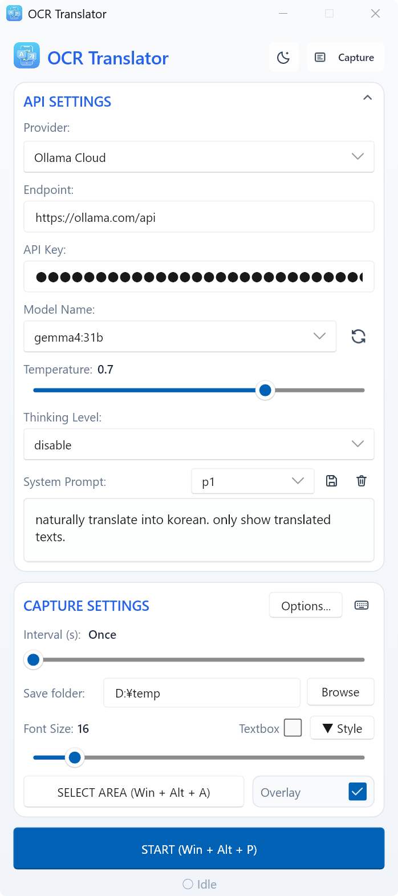
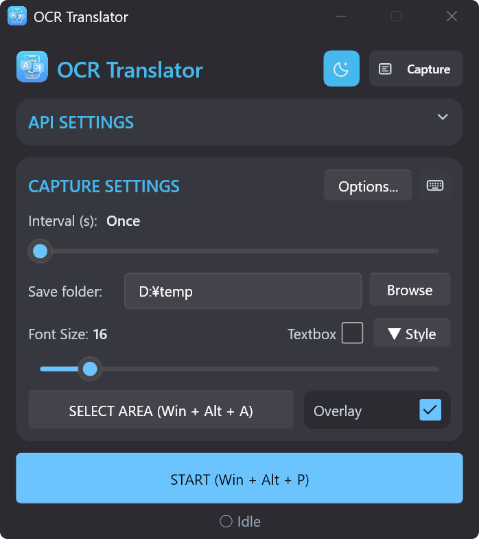
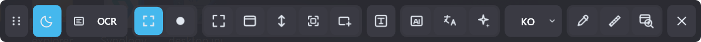

# Rust OCR Translator powered by VLM

A real-time screen OCR, translation and capture tool built with Rust and Slint powered by VLM (Vision-Language Model).

 

Capture toolbar (dark theme)

## Features
- **Modern UI**: Dark mode, glassmorphism, and Windows 11 Mica backdrop for the main control window.
- **Toggleable Overlay**: Dedicated toggle and logic to hide/show the translation box without stopping the OCR process.
- **Interactive Region Selection**: Drag your mouse to select exactly what you want to translate. While the magnifier is visible, use the **arrow keys** to move the cursor by one physical screen pixel, including while dragging. Release the mouse button to capture the adjusted region. Supports **Escape** to cancel.
- **Auto-Automation**: Selecting a region automatically starts the capture process for immediate results.
- **Change Detection**: Continuous mode compares Windows OCR text and waits for two identical consecutive samples before calling the VLM. Animated backgrounds do not trigger requests when the recognized text stays the same. Empty/unavailable OCR falls back to stable pixel comparison. Interval 0 performs an immediate one-shot request.
- **Responsive cancellation and retry**: Stop or changing regions cancels pending requests. Transient failures retry with backoff or `Retry-After`; HTTP 4xx errors except 429 stop translation and show a short error.
- **Translation options**: Open **Options...** in **CAPTURE SETTINGS** for a glossary (`source=translation`, one entry per line) and an option to skip empty OCR and clear the overlay. Skipping defaults to off to support fonts Windows OCR may miss.
- **Dialogue context**: Continuous translation uses the last three completed lines and your glossary for consistency.
- **Streaming results**: Continuous translation and toolbar VLM/OCR+Translate show output as it arrives. Only completed translations are copied to the clipboard.
- **Image quality**: VLM images retain their original size up to one million pixels; larger images shrink proportionally. JPEG quality is 92, preserving wide subtitle strips without upscaling small captures.
- **Customizable Overlay**: Instantly change background color, text color, transparency, and separate textbox to match your preference.
- **Textbox mode & Click-Through**: Enable Textbox mode to hide the overlay's close button and allow **Click-Through Interaction**, letting you click applications behind the capture area while still seeing the translation boundary.
- **Markdown results**: The textbox renders headings, emphasis, lists, quotes, code blocks, and tables. Automatic clipboard sync and **Ctrl+C** retain the original Markdown text.
- **Dynamic scaling**: Font size automatically adjusts to fit the text within your selected area.
- **Clipboard Sync**: Translated text is automatically copied to the system clipboard for easy use elsewhere.
- **Multi-API Support**: 
  - **Cloud Providers**:
    - **Google Gemini, Cerebras, Ollama Cloud, OpenCode Go, OpenCode Zen**: API key stored in Windows Credential Manager.
  - **Local Providers**:
    - **Ollama, Unsloth Desktop, LMStudio / Custom**
- **Adjustable Creativity**: Use the **Temperature** slider (0.0 - 1.0) to control translation consistency vs. creativity.
- **Configurable Global Hotkeys**: 
  - **Win + Alt + A**: Trigger area selection (default).
  - **Win + Alt + P**: Start or Stop the translation process (default).
  - Up to **three capture-toolbar shortcuts** can run Fullscreen / Window / Region capture, OCR, OCR + Translate, VLM, color picker, ruler, or window magnifier. Every binding is remappable from the keyboard button next to the **CAPTURE SETTINGS** title.
- **Capture Mode**: Compact always-on-top toolbar (`Capture` ↔ `OCR` toggle).
  - Frame mode opens a movable, resizable transparent capture frame with its own Capture and Record controls.
  - Fullscreen / Window / Scrolling (Windows only) / Region (`Esc` to cancel).
  - One-shot OCR, OCR+Translate, VLM, color picker, ruler.
  - **Window magnifier**: Zoom **50–400%** in 1% steps.
    - Translation overlays, the result textbox and other visible app overlays stay above the magnified preview without taking keyboard focus from the source window.
    - **Ctrl+Alt+F12** closes the magnifier and restores the source window.
  - For one-shot OCR and OCR+Translate, the language dropdown lists only installed Windows OCR packs with short labels such as **KO**, **JP**, and **EN**.
  - OCR+Translate preserves and copies the recognized source text if translation fails, with the error shown in the toolbar status.
  - PNG/MP4 saved as `YYYY-MM-DD_001...` + clipboard copy; recording looks for `ffmpeg.exe` beside the application first, then on `PATH`. Single-monitor recording first tries ddagrab/NVENC and retries with software capture/libx264 if startup fails. NVIDIA hardware is optional; the FFmpeg build must include libx264 for software recording.

## Shortcuts

All global shortcuts are configurable. Click the keyboard icon on the right side of the **CAPTURE SETTINGS** card to open the **Shortcut settings** window, edit the slots, and press **Save**. Bindings are written to `ocr_trans.ini` under `[shortcuts]` and are restored on the next launch.

| Slot | Default | Purpose |
| --- | --- | --- |
| Select area | `Win + Alt + A` | Open the region selector |
| Start | `Win + Alt + P` | Start / stop the translation process |
| Capture toolbar 1 | *(not set)* | Run a chosen capture-toolbar action |
| Capture toolbar 2 | *(not set)* | Run a chosen capture-toolbar action |
| Capture toolbar 3 | *(not set)* | Run a chosen capture-toolbar action |

- Each slot combines **Win / Alt / Ctrl / Shift** with a single key: **A-Z**, **0-9**, **F1-F12**, **PrintScreen**, and the punctuation keys **` , . / ; ' [ ] \ - =**.
- Only **Select area** and **Start** come with defaults; the three capture-toolbar slots start empty.
- A capture-toolbar slot also selects the action to run: **Fullscreen**, **Window**, or **Region** capture, **OCR**, **OCR + Translate**, **VLM**, **Color picker**, **Ruler**, or **Window magnifier**.
- At least one modifier and one key are required. A slot that has an action but no key is rejected instead of saved.
- Shortcuts are registered globally, so they keep working while the application is in the background.

## Prerequisites
- **Rust**: 1.92 or newer. [Install Rust](https://www.rust-lang.org/tools/install)
- **C++ Build Tools**: Required for `windows-rs` and `slint`.

## Getting Started

### 📥 Download
You can download the latest version from the [Releases Page](https://github.com/kirinonakar/ocr_trans/releases).

### Manual build

1. Clone the repository.
2. Run `cargo run --release`. Or `cargo build --release` to generate the binary.
3. Open the main window:
   - Select your provider (LMStudio, Google Gemini, Cerebras, Ollama, Ollama Cloud, Unsloth Desktop, OpenCode Go, or OpenCode Zen).
   - Click **SELECT AREA** and drag to select the region you want to translate (e.g. subtitles).
   - Capture starts automatically. Use the **STOP** button to pause, or **Win + Alt + A** to re-select the area.
   - Use the **Overlay** checkbox to hide/show the translation text while running.
   - Use the **Textbox** mode to move translations into a separate, draggable window.

### 🎨 Customization
- Click the **▼ Style** button next to Font Size to reveal customization options.
- **Background Color**: Choose from various presets including Dark, Light, and Paper-like themes. The selected color is highlighted.
- **Text Color**: Select a readable contrast for your chosen background.
- **Opacity**: Use the slider to adjust how much of the original screen shows through the overlay. Changes are reflected in real-time.
- **Dynamic Scaling**: The application automatically adjusts font size to fit the content within your chosen area.
- **Textbox Mode**: Optionally display translation results in a separate, resizable window while keeping the overlay active (at 10% opacity) for better focus. In this mode, the overlay's close button is hidden and **Click-Through Interaction** is enabled, allowing you to click on applications behind the capture area.

## Project Structure
- `src/main.rs`: Module declarations and asynchronous entry point.
- `src/app.rs`, `startup.rs`: Application orchestration, window setup and initial settings.
- `src/providers.rs`: Shared provider definitions, endpoints, credential targets, model defaults, protocols and model-specific thinking rules. Startup and provider switching use the same definitions.
- `src/provider_ui.rs`, `settings.rs`, `credentials.rs`: Provider callbacks/model synchronization, compatible INI/legacy settings, and Credential Manager access.
- `src/runtime_workers.rs`, `capture_workflow.rs`: Continuous translation/cancellation/retries and capture-toolbar action workflows.
- `src/ocr.rs`: Windows OCR integration and an opt-in initialization benchmark.
- `src/capture.rs`: Shared capture types and entry points.
- `src/capture/desktop.rs`, `window.rs`: Desktop/monitor capture and window shape handling.
- `src/capture/output.rs`, `change_detection.rs`: File/clipboard export and frame comparison.
- `src/capture/scrolling.rs`, `scrolling/alignment.rs`: Scroll capture/stitching and frame alignment.
- `src/capture/recording.rs`, `recording/`: FFmpeg lifecycle, video delivery, and WASAPI audio.
- `src/api.rs`: Multi-modal AI client (Gemini/OpenAI).
- `src/win_utils.rs`: Windows-specific UI hacks (layered windows, click-through, Mica).
- `ui/main.slint`: Public Slint window/type exports compiled by `build.rs`.
- `ui/windows/`: OCR settings, capture toolbar/frame, results, translation overlay, selector, and shortcuts.
- `ui/components/`, `ui/types/`: Shared toolbar button and markdown result data types.

## License
This project is licensed under the MIT License - see the [LICENSE](LICENSE) file for details.

### Slint license notice

This application uses **Slint** (version 1.17) as its UI toolkit. Slint is copyright © SixtyFPS GmbH and is **not** covered by this project's MIT license. It is available separately under:

- **GPLv3** — for open source applications, provided the complete work is made available under the GPLv3.
- **Slint Royalty-free Desktop, Mobile, and Web Applications License** — for proprietary desktop, mobile, and web applications, with attribution to Slint.
- **Commercial licenses** — see [slint.dev/pricing](https://slint.dev/pricing).

This repository relies on the Slint Royalty-free license and satisfies its attribution requirement by displaying the [Slint attribution badge](https://github.com/slint-ui/slint/tree/master/logo) in this README, linked to <https://slint.dev>. If you publish builds of this application, keep that badge on the download page (or show the `AboutSlint` widget in an About dialog) to stay compliant.

The MIT license above applies only to this project's own source code. Slint and its bundled third-party components remain under their respective licenses; see the [Slint license files](https://github.com/slint-ui/slint/tree/master/LICENSES) for details.

